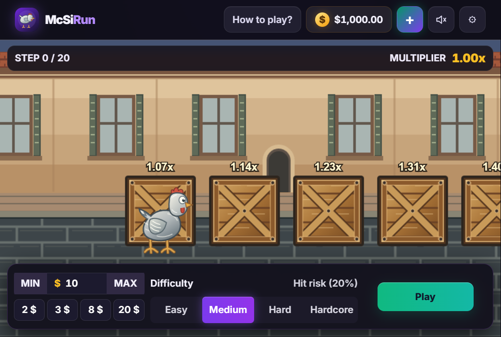

[Демо на GitHub Pages](https://mcsimusic.github.io/McSiRun/) - доступно после первой успешной публикации.

# McSiRun

McSiRun - браузерная аркада в духе CS 1.6: проведите курицу по 20 ящикам на улице cs_italy, увеличивая множитель и решая, когда забрать выигрыш.



<p>
  
  
  
</p>

Все ставки, баланс и предметы виртуальные: реальные деньги не используются.

## Как играть

1. Выберите ставку и сложность, затем нажмите **Play**.
2. Каждый безопасный прыжок повышает множитель. Нажмите **GO**, чтобы продолжить, или **Cash Out**, чтобы забрать выигрыш.
3. На 10-м шаге можно забрать пистолет или продолжить. На 20-м шаге автоматически начисляется максимальный выигрыш и AWP | Dragon Lore.
4. При попадании снайпера раунд заканчивается без выигрыша. Баланс можно пополнить демо-средствами кнопкой **+**.

Игра адаптируется к телефону и компьютеру, поддерживает английский и русский языки, звуковые эффекты и установку как PWA. Звук по умолчанию выключен.
После попадания повторный запуск доступен, когда завершится анимация и появится результат.

## Запуск локально

Требуется Node.js 20.9 или новее.

```bash
npm ci
npm run dev
```

Откройте [http://localhost:3000](http://localhost:3000). Баланс, настройки и история сохраняются в `sessionStorage` текущей вкладки, настройка звука - в `localStorage`.

## Технологии

- Next.js и TypeScript для интерфейса, Redux Toolkit для состояния.
- PixiJS и SVG для игровой сцены и анимаций, Web Audio API для звука.
- GitHub Actions проверяет линтер, типы, тесты и production-сборку. После успешной проверки push в `main` публикует статическую сборку на GitHub Pages.

## Проверки

```bash
npm run lint
npx next typegen
npx tsc --noEmit
npm test
npm run build
```

GitHub Pages использует отдельную статическую сборку с префиксом `/McSiRun`. Изменения появятся в демо после загрузки в `main` и успешного выполнения workflow **CI**.
